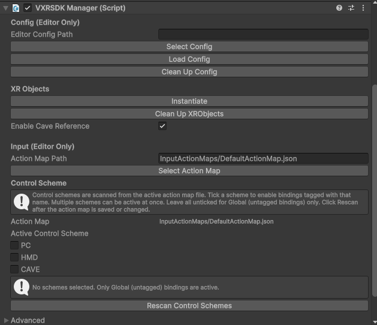

# VotanicXR2 SDK Unity

## Installation
1. Open Unity and open Unity Package Manager via `Window > Package Manager`.
2. Click "+" button and select `Add package from git URL`.
3. Enter the following URL: https://github.com/VOTANIC/VotanicXR2-SDK-Unity.git?path=/Unity6

## Resources
In `Default_Resources`, there are default configs (`*.vxr2`) and default action maps (`*ActionMap.json`).
Config is optional. But action map is required, so please copy the default action maps to `StreamingAssets` in your project and reference it in VXR SDK Manager.
